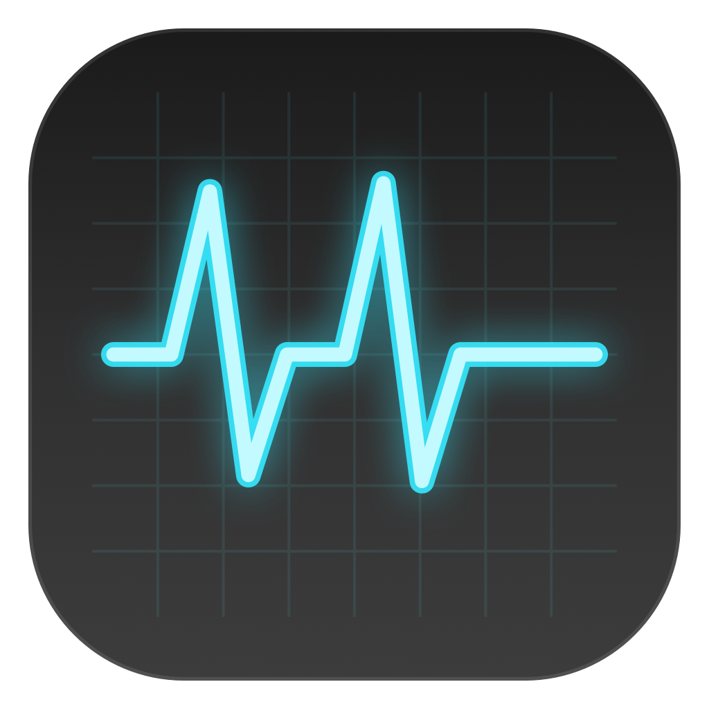

<div align="center">
  
  <h1>NewNet</h1>
  <p><strong>The ultimate lightweight, native macOS menu-bar utility suite and media manager.</strong></p>

  [](https://apple.com/macos)
  [](LICENSE)
  [](https://github.com/sfdcnaveen/NewNet/releases)
  [](https://github.com/sfdcnaveen/NewNet/releases)
</div>

<br>

**NewNet** is a high-performance, native macOS menu-bar companion crafted with SwiftUI and Apple's Liquid Glass design language. It combines a lightning-fast media downloader powered by `yt-dlp` and bundled `ffmpeg`, automated music scrobbling, live network speed monitoring, and a powerful suite of native macOS workflow utilities—all residing discreetly in your menu bar.

---

## ✨ Features & Utilities

### 🛠 macOS Utilities Suite

* **☕️ Keep Awake (Display & Clamshell Mode):**
  * Prevent display and system idle sleep with a single click.
  * Choose indefinite keep-awake or timed presets (`15m`, `30m`, `1h`, `2h`) with additive extension.
  * **Keep Awake when Lid is Closed:** Uses kernel-level power management (`pmset disablesleep 1`) so your MacBook continues running workloads with the display lid closed.
  * **Fail-Safe Restoration:** Automatically restores standard macOS sleep settings (`disablesleep 0`) on deactivation or application quit, preventing permanent insomnia.
  * **Battery Safeguard:** Displays battery level and automatically releases assertions when battery drops below 10% to prevent unexpected drainage.

* **📋 Clipboard History:**
  * Fast, persistent, and searchable clipboard memory for text, URLs, images, and files.
  * Pin frequently used clips to keep them at the top.
  * Filter clips by category (Text, Links, Images, Files) with instant one-click copy and deletion.
  * Zero cloud sync; stored safely and locally on your Mac.

* **🖱 Inverse Mouse Scrolling:**
  * Reverses physical mouse wheel scroll direction to match standard desktop behavior.
  * **Intelligent Trackpad Preservation:** Detects physical mouse wheels based on gesture momentum and scroll phases—preserving macOS natural scrolling gestures on built-in trackpads and Magic Mice.
  * Radical simplicity: Controlled via a single, self-explanatory toggle with zero confusing sub-options.

* **✂️ Finder Cut & Paste:**
  * Brings true cut-and-paste file management to macOS Finder.
  * Press **⌘X** on selected files in Finder to mark them for moving, then press **⌘V** in your destination folder to move them instantly.
  * Replaces the cumbersome two-handed ⌥⌘V shortcut with standard, familiar muscle memory.

* **🛑 Real-Time Quit on Close:**
  * Automatically and gracefully terminates GUI applications (`app.terminate()`) the moment their last standard window (`kAXStandardWindowSubrole`) is closed.
  * Eliminates orphaned background processes and frees up system memory.
  * **Safe Exclusions:** Finder, web browsers, user-configured exceptions, and NewNet are strictly protected from accidental termination.

---

### 🎵 Music Scrobbling (Last.fm & ListenBrainz)

* **Dual-Service Sync:** Seamlessly scrobble your music listening history to both **Last.fm** and **ListenBrainz**.
* **Zero-Setup Player Detection:** Automatically detects currently playing tracks, artists, and album artwork from **Apple Music** and **Spotify**.
* **Interactive Dashboard:** View real-time playback progress, scrobble eligibility countdowns, and media controls (Play/Pause, Next, Previous) directly from the menu bar.
* **Secure Credentials:** Auth tokens and session keys are encrypted in your macOS Keychain.

---

### ⚡️ Media Downloader & Converter (`yt-dlp`)

* **Menu-Bar Native UI:** Instantly paste video and media URLs from YouTube, Twitter/X, Vimeo, Reddit, and hundreds of sites.
* **Explicit Format Selection:** Choose your preferred video resolution (4K, 1080p, 720p), framerate, and audio codecs before downloading.
* **Audio Extraction & Ringtones:** Directly extract audio as MP3 or M4A with automatic ID3 tagging and embedded artwork.
* **GIF Clip Generation:** Create animated GIFs directly from videos with 3s, 5s, and 10s presets or custom time ranges.
* **Auto-Merging:** Bundled `ffmpeg` merges separate high-resolution video and audio streams automatically.
* **Resumable Downloads:** Direct download engine with pause and resume support.

---

### 📊 Network Speed Monitor & Speed Test

* **Menu Bar Bandwidth Indicator:** Compact, real-time download and upload transfer rates in the menu bar.
* **Network Dashboard:** Visual traffic graphs and interface statistics (Wi-Fi, Ethernet).
* **Process Attribution:** Opt-in real-time monitoring of which background apps are consuming bandwidth.
* **Cloudflare Speed Test:** Integrated multi-threaded latency, download, and upload speed test with history tracking.

---

### 🔒 Privacy & Architecture

* **Zero Telemetry:** No tracking, no background analytics, and no external advertising networks.
* **Native Liquid Glass Design:** Fully responsive dark and light mode adaptation, Dynamic Type, and accessible contrast.
* **Automatic Updates:** Silent and verified in-app OTA updates powered by Sparkle with Ed25519 cryptographic signatures.

---

## 🚀 Installation

### Option 1: Direct Download (Recommended)
1. Download the latest **`NewNet.dmg`** from the [Releases](https://github.com/sfdcnaveen/NewNet/releases) page.
2. Open the disk image and drag **`NewNet.app`** into your **`/Applications`** folder.
3. Launch NewNet from Spotlight or Launchpad.

> *Note: For macOS utilities (Clipboard History, Finder Cut & Paste, Quit on Close, Mouse Inversion), grant Accessibility permission when prompted in System Settings.*

### Option 2: Homebrew (Coming Soon)
```bash
brew install --cask newnet
```

---

## 💻 Building from Source

### Prerequisites
* macOS 15.0+ with Xcode 16+ / Command Line Tools
* `python3`, `xcodegen`, `xcbeautify`

```bash
# Clone the repository
git clone https://github.com/sfdcnaveen/NewNet.git
cd NewNet

# Diagnose environment and build debug binary
make diagnose
make build

# Run automated test suites
make test

# Build and package signed release DMG
make package
```

The resulting distributable DMG will be generated at `build/NewNet.dmg`.

---

## 📄 License

This project is licensed under the MIT License - see the [LICENSE](LICENSE) file for details.
